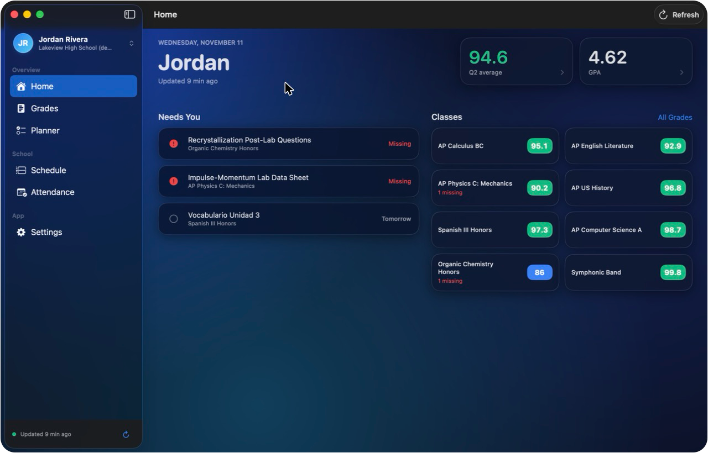
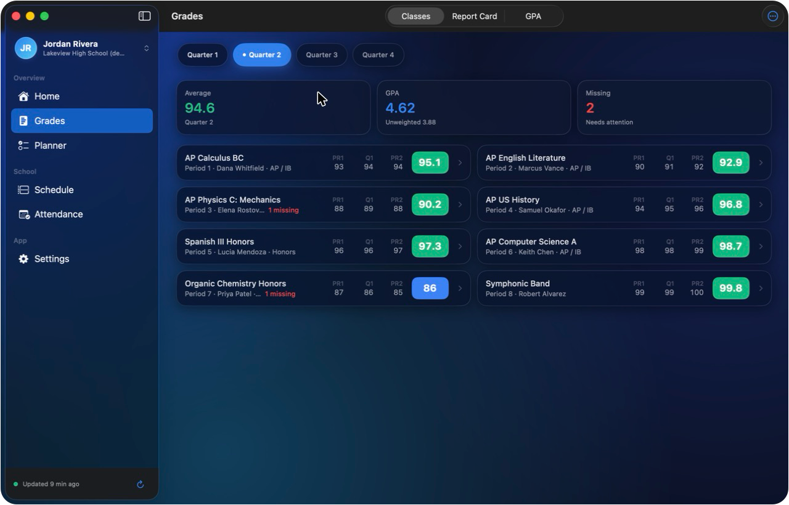
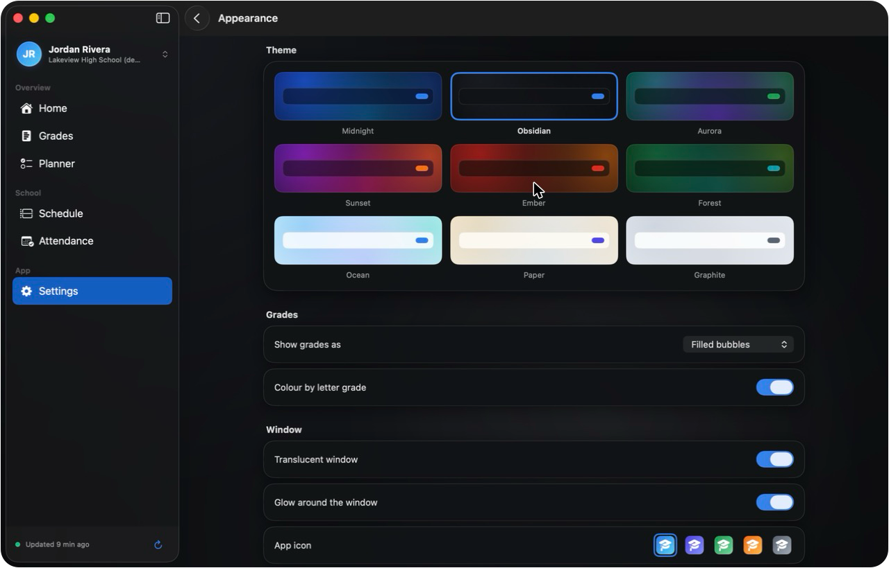
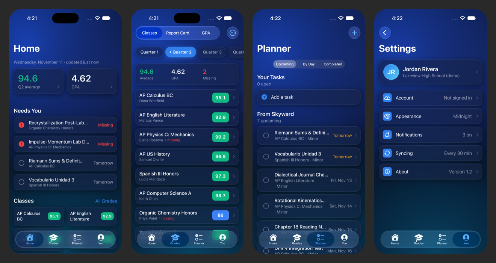

<p align="center">
  
</p>

<h1 align="center">Skyward Plus</h1>

<p align="center">
  Your Skyward grades in a real Mac app.<br>
  <a href="https://github.com/ninjex2009-code/skyward-plus/releases/latest"><strong>Download for Mac</strong></a>
  &nbsp;·&nbsp; macOS 14 or newer &nbsp;·&nbsp; Apple silicon and Intel
</p>

<p align="center">
  
</p>

Skyward Plus signs in to your school district's own Skyward page and puts
grades, assignments, GPA, schedule and attendance in one window, with a menu
bar view and alerts when something changes. It is a beta, and it is not
affiliated with or endorsed by Skyward.

## What it does

**Home shows what needs you.** Missing work, what's due today or tomorrow, and
classes under their goal come first, then your classes at a glance.

**Grades, report cards and GPA in one place.** Each quarter's classes, every
assignment and category weight, what-if scores, goals, report cards, progress
reports, your transcript, and weighted and unweighted GPA.

**Planner.** Skyward due dates and your own tasks together. Swipe to finish on
iPhone; due dates can copy to Reminders or Calendar.

**Sync with Google.** Optional: sign in with Google and your planner, done
marks, goals and theme stay the same on your Mac and iPhone. Grades never leave
your devices.

**Nine themes.** Midnight, Obsidian, Aurora, Sunset, Ember, Forest, Ocean, Paper and
Graphite: slowly drifting colour behind frosted glass, each with its own look
and accent.

**Built for every size.** On a big Mac window everything scales up and lists
spread into columns; on iPhone it is four simple tabs.

<p align="center">
  
  
</p>
<p align="center">
  
</p>

The screenshots show the built-in sample student. You can try it the same way:
choose **Try it with a sample student** during setup.

## Install

1. Download `Skyward-Plus-x.y.dmg` from the
   [latest release](https://github.com/ninjex2009-code/skyward-plus/releases/latest).
2. Open it and drag **Skyward Plus** onto **Applications**.
3. Allow it once. The app is not signed with a paid Apple developer account,
   so macOS blocks it the first time. Either:
   - double-click **Allow Skyward Plus.command** in the disk image, or run

     ```bash
     xattr -dr com.apple.quarantine "/Applications/Skyward Plus.app"
     ```

   - or open the app, click **Done** on the warning, then go to
     System Settings > Privacy & Security and click **Open Anyway**.

After that the app updates itself: it checks this page for a newer release and
offers to install it.

### iPhone (sideload)

Each release also has an unsigned `Skyward-Plus-x.y.ipa`. Install it with
[Sideloadly](https://sideloadly.io) or AltStore using your own Apple ID, then
trust it in Settings › General › VPN & Device Management and turn on Developer
Mode. With a free Apple ID it has to be re-installed every 7 days.

## Privacy

Grades stay on your devices. You type your password into your district's own
sign-in page; if you turn on **Stay signed in**, it is kept in the Keychain.
If you sign in with Google, only your planner, done marks, goals and theme are
synced, to a database only your account can read. The app talks to your
district's Skyward, to Google for that optional sync, and to GitHub for updates.

## Which districts work

Districts on the newer Skyward (Qmlativ) that sign in through a district
portal are the tested path. Classic Skyward Family Access is supported but
less tested. If your district does not work, open an
[issue](https://github.com/ninjex2009-code/skyward-plus/issues) with the
district name and what you saw. Do not include your password or grades.

## Build from source

Needs Xcode 16 or newer and [XcodeGen](https://github.com/yonaskolb/XcodeGen).

```bash
cd app
xcodegen generate
open SkywardPlus.xcodeproj
```

`app/tools/make-dmg.sh` builds the universal release and the disk image into
`app/dist/`. Tests run from the `CoreTests` scheme. Google sync needs a
`GoogleService-Info.plist` from your own Firebase project in
`app/SkywardPlus/Resources/` (see [docs/FIREBASE_SETUP.md](docs/FIREBASE_SETUP.md));
without it the app works and simply hides sync.

## Chrome extension

The repository root also holds the original **Skyward+** Chrome extension
(`manifest.json`, `src/`, `popup/`, `dashboard/`). It reads the gradebook from
the Skyward page in your browser. To use it, open `chrome://extensions`, turn
on Developer mode, and choose **Load unpacked**.
