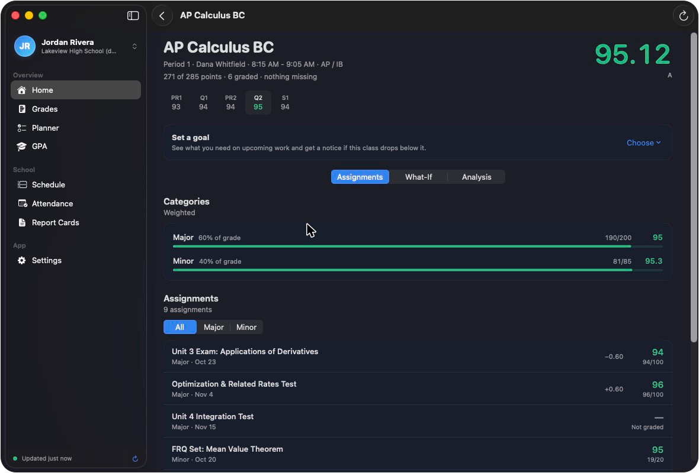
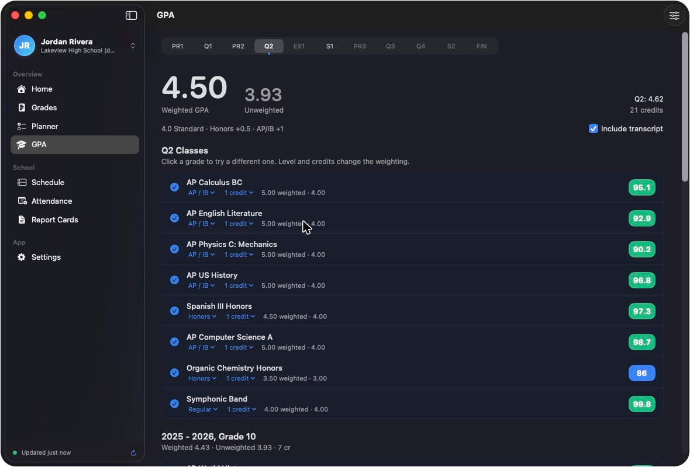

<p align="center">
  
</p>

<h1 align="center">Skyward Plus</h1>

<p align="center">
  Your Skyward grades in a real Mac app.<br>
  <a href="https://github.com/ninjex2009-code/skyward-plus/releases/latest"><strong>Download for Mac</strong></a>
  &nbsp;·&nbsp; macOS 14 or newer &nbsp;·&nbsp; Apple silicon and Intel
</p>

<p align="center">
  
</p>

Skyward Plus signs in to your school district's own Skyward page and puts
grades, assignments, GPA, schedule and attendance in one window, with a menu
bar view and alerts when something changes. It is a beta, and it is not
affiliated with or endorsed by Skyward.

## What it does

**Grades.** Every class and marking period, category weights, and each
assignment's score with how much it moved your average.

**What-if and goals.** Change a score or add a future one and watch the
average move. Set a goal for a class and see what you need on the next test.

**GPA.** Weighted and unweighted, with the level and credits of each class
adjustable, plus report cards and your transcript.

**Planner.** Skyward due dates and your own tasks in one list. Due dates can
copy to Reminders or Calendar.

**In the background.** A menu bar view, a sync every 30 minutes, and
notifications for new grades, work due tomorrow, and a class that drops below
its goal.

**Fast.** Command-K searches every class, assignment and screen.

<p align="center">
  
  
</p>

The screenshots show the built-in sample student. You can try it the same way:
choose **Try it with a sample student** during setup.

## Install

1. Download `Skyward-Plus-x.y.dmg` from the
   [latest release](https://github.com/ninjex2009-code/skyward-plus/releases/latest).
2. Open it and drag **Skyward Plus** onto **Applications**.
3. Allow it once. The app is not signed with a paid Apple developer account,
   so macOS blocks it the first time. Either:
   - double-click **Allow Skyward Plus.command** in the disk image, or run

     ```bash
     xattr -dr com.apple.quarantine "/Applications/Skyward Plus.app"
     ```

   - or open the app, click **Done** on the warning, then go to
     System Settings > Privacy & Security and click **Open Anyway**.

After that the app updates itself: it checks this page for a newer release and
offers to install it.

## Privacy

Everything stays on your Mac. You type your password into your district's own
sign-in page. If you turn on **Stay signed in**, it is kept in the macOS
Keychain. The app talks to your district's Skyward and, for updates, to
GitHub. Nothing else.

## Which districts work

Districts on the newer Skyward (Qmlativ) that sign in through a district
portal are the tested path. Classic Skyward Family Access is supported but
less tested. If your district does not work, open an
[issue](https://github.com/ninjex2009-code/skyward-plus/issues) with the
district name and what you saw. Do not include your password or grades.

## Build from source

Needs Xcode 16 or newer and [XcodeGen](https://github.com/yonaskolb/XcodeGen).

```bash
cd app
xcodegen generate
open SkywardPlus.xcodeproj
```

`app/tools/make-dmg.sh` builds the universal release and the disk image into
`app/dist/`. Tests run from the `CoreTests` scheme.

## Chrome extension

The repository root also holds the original **Skyward+** Chrome extension
(`manifest.json`, `src/`, `popup/`, `dashboard/`). It reads the gradebook from
the Skyward page in your browser. To use it, open `chrome://extensions`, turn
on Developer mode, and choose **Load unpacked**.
